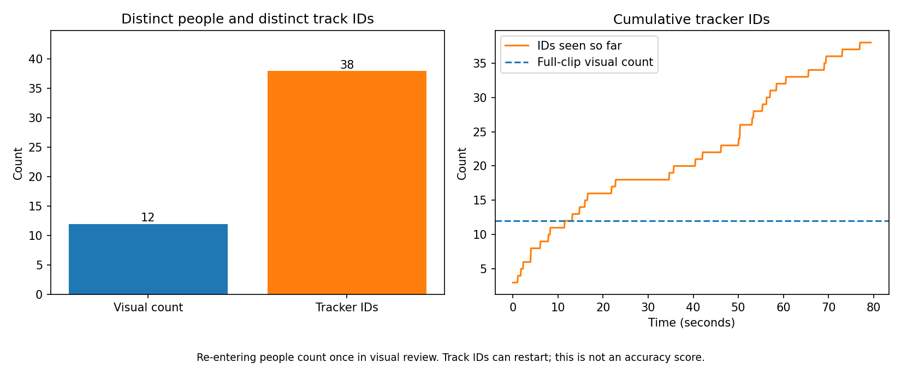
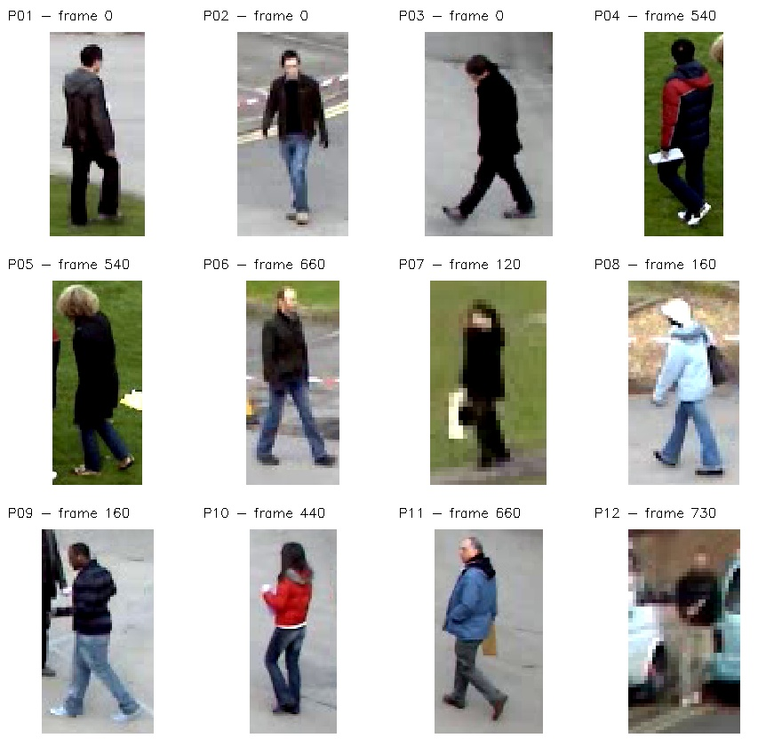
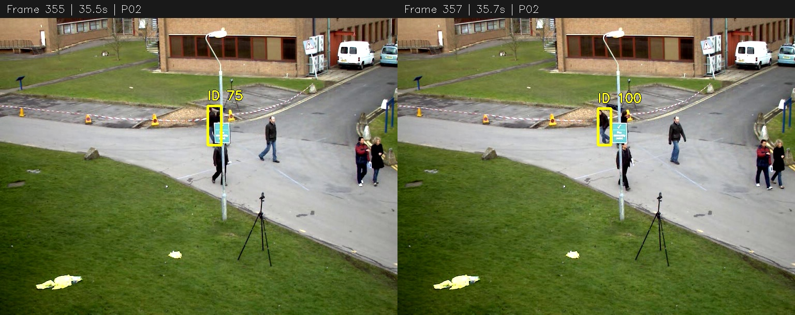

# Week 4: Person Tracking with YOLO11n and ByteTrack

This project adds tracking to person detection. It shows an ID for each tracked person, counts distinct tracker IDs, compares them with a separate visual count, and shows one observed ID change.

## Assignment coverage

| Class task | Included work |
| --- | --- |
| Show each person's tracking ID on a video | [Complete tracking video](outputs/people_tracked.mp4) |
| Count unique people with tracking | A `seenIds` set, frame counts and track tables |
| Compare with a manual count and explain the difference | Visual identity ledger, count chart and discussion below |
| Find an ID switch and note its frame and likely cause | Frames 355 and 357, with an evidence image |
| Push the work and share the repository link | [Submission repository](https://github.com/fayzliaqat/week4-person-tracking) |

## Setup

Use Python 3.11 or newer. In Windows PowerShell, open this project folder and run:

```powershell
python -m venv .venv
.\.venv\Scripts\python.exe -m pip install -r requirements.txt
.\.venv\Scripts\python.exe track_people.py
.\.venv\Scripts\python.exe analyse_tracking.py
```

The first run downloads `yolo11n.pt` into `models/`. Internet is needed for that download and package installation. The model is pretrained; no training or GPU is needed. Tracking processes the whole video and replaces the generated files in `results/` and `outputs/`. The original input is kept unchanged.

To use the notebook instead:

```powershell
.\.venv\Scripts\python.exe -m notebook person_tracking.ipynb
```

Open it from this project folder and run its cells from top to bottom. It contains the same tracking and analysis steps and performs fresh inference. Included outputs show a completed run, so they can be inspected without running the code first.

## Input and settings

The input is OpenCV's unchanged `vtest.avi` sample: **768 x 576**, **10 FPS**, **795 frames**, **79.5 seconds**. It is clearer for visual counting than the defocused sample from the earlier assignments. Source and licence notices are in [data/README.md](data/README.md).

- Detector: pretrained YOLO11n, person class `0`
- Tracker: ByteTrack with the included `bytetrack.yaml`
- Persistence: `persist=True` keeps tracking state between frames
- Detector confidence cutoff: `0.1`, allowing the tracker's lower-confidence matching stage
- Image size setting: `640`; NMS IoU: `0.7`; device: CPU
- Tracker high/low thresholds: `0.25` / `0.1`; new-track threshold: `0.25`
- Track buffer: `30`; matching threshold: `0.8`; score fusion enabled

The CSV tables preserve confidence scores and boxes. The video uses short ID labels for readability. Frames without an assigned track ID do not add a person to the set. IDs can have gaps: **38 observed IDs** is not the same as the largest ID number, which is **179** in this run.

## Count comparison

| Method | Count |
| --- | ---: |
| Manual visual review: distinct visible people | 12 |
| Distinct IDs emitted by ByteTrack | 38 |
| Tracker IDs minus visual count | +26 |



The visual review follows people by clothing, appearance and movement through the full clip. A person who turns around or re-enters is counted once. Distant and partly visible people are included when a separate person is discernible. The ledger is in [data/manual_people.csv](data/manual_people.csv), with the counting convention and uncertainties in [data/manual_review.json](data/manual_review.json).

The two counts differ because a tracker ID is not a permanent identity. This video contains crossings, occlusion and repeated movement out of view. Broken tracks and re-entry can assign another ID to the same person. Brief false person tracks can also increase the result, while missed people can reduce it. These are possible contributors; the project does not attribute every extra ID to a verified cause. The difference of 26 is a net count difference, not a count of ID switches or false positives.

The visual count is a review estimate, not official dataset ground truth. The full-clip reference line in the chart shows the final visual count; it does not mean all 12 people are visible at every instant.



## One observed ID change



**P02** in the visual ledger wears a dark brown jacket and blue jeans. That person has **ID 75 at frame 355 (35.5 s)**, then **ID 100 at frame 357 (35.7 s)**. Both labels refer to the same visually followed person.

The person passes behind the central pole/sign while another black-clothed person crosses nearby. The partial occlusion and changed boxes likely disrupted the association. This is an explanation from the visible scene; the tracker does not report its internal reason for losing the match.

The class describes receiving a new ID as an ID switch. More specifically, this example is track fragmentation followed by a new ID, rather than a demonstrated swap of two people's IDs. It is a manually inspected example, not an automated ID-switch-rate measurement. Frame numbering is **zero-based**: frame 357 is the **358th frame**.

## Files

- `person_tracking.ipynb`: executed step-by-step notebook
- `track_people.py`: complete detector, tracker, ID set and H.264 video export
- `analyse_tracking.py`: count comparison, chart and checked ID-change frames
- `data/`: original sample, source notices and visual review
- `results/tracks.csv`: every emitted track box and score
- `results/frame_counts.csv`: current tracks and cumulative distinct IDs for all frames
- `results/track_summary.csv`: first/last observations and number of observations per track ID
- `results/run_info.json`: settings, package versions and input/model/config hashes
- `outputs/`: complete tracking video, previews, count chart and ID-change evidence
- `CLASS_NOTES.md`: simple explanations of the tracking concepts

## Limitations

This is one fixed-camera video with a pretrained detector and a simple tracker. It does not use appearance re-identification. It can lose people behind objects, start another ID after a break, or miss small background people.

The visual identity ledger is not a frame-by-frame ground-truth box annotation. No accuracy, precision, recall, mAP, MOTA or IDF1 is claimed. If the input, model, tracker settings or software versions change, the visual review and ID-change example must be checked again. `analyse_tracking.py` checks the reviewed video hash and the stated IDs/frames before making the evidence image.

## References and licences

- [Ultralytics tracking documentation](https://docs.ultralytics.com/modes/track/)
- [YOLO11 documentation](https://docs.ultralytics.com/models/yolo11/)
- [OpenCV sample source](https://github.com/opencv/opencv/blob/4.x/samples/data/vtest.avi)

Project code uses **AGPL-3.0**, included in [LICENSE](LICENSE). The sample comes from OpenCV and retains its source attribution and the notices in [data/OPENCV_LICENSE.txt](data/OPENCV_LICENSE.txt).
